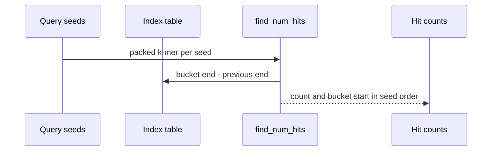
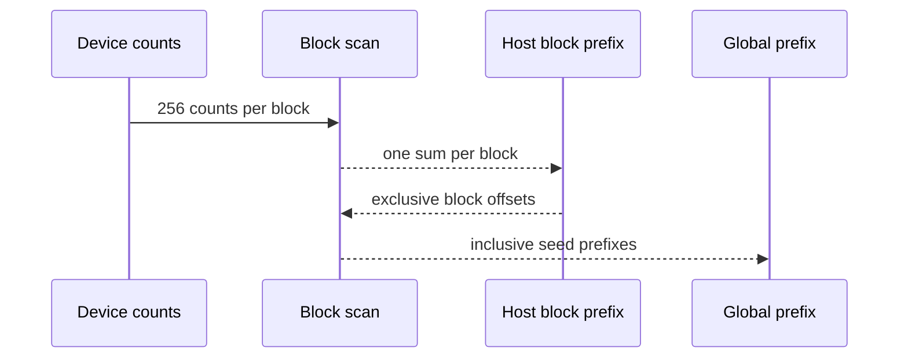
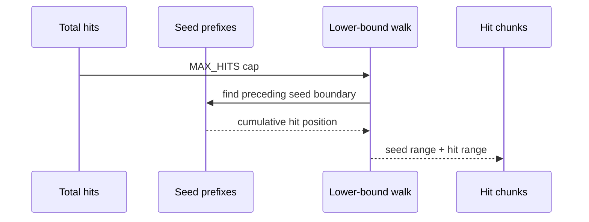
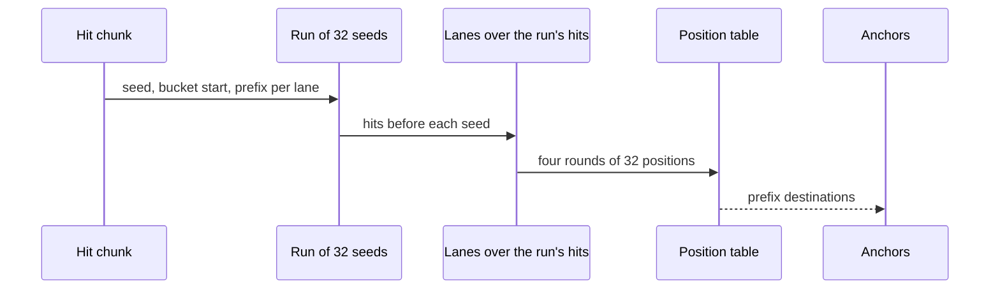
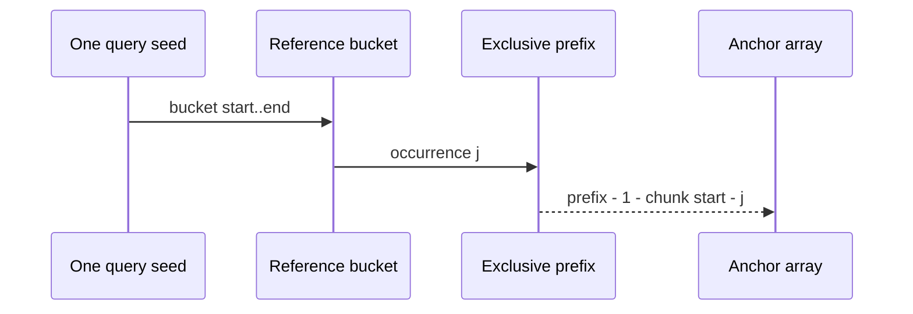
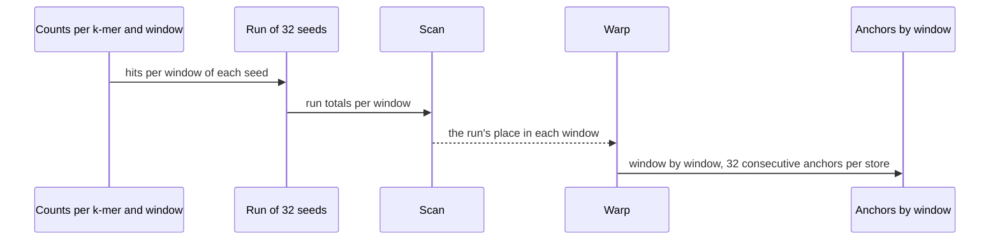
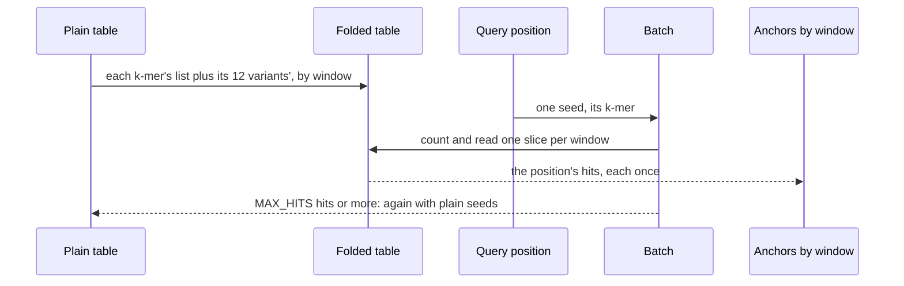

# Query seeds become ordered anchors

<!-- @source: src/gpu/kernels.rs::find_num_hits -->
<!-- @source: src/gpu/kernels.rs::scan_blocks -->
<!-- @source: src/gpu/mod.rs::chunk_limits -->
<!-- @source: src/gpu/mod.rs::chunk_limits_sparse -->
<!-- @source: src/gpu/mod.rs::exclusive_scan_hit_totals -->
<!-- @source: src/gpu/kernels.rs::find_hits_dense -->
<!-- @source: src/gpu/kernels.rs::find_hits_dense_warp -->
<!-- @source: src/gpu/mod.rs::use_warp_find_hits -->
<!-- @source: src/gpu/kernels.rs::bucket_nibbles -->
<!-- @source: src/gpu/kernels.rs::run_bucket_counts -->
<!-- @source: src/gpu/kernels.rs::find_hits_groups_bucketed -->
<!-- @source: src/gpu/kernels.rs::fold_counts -->
<!-- @source: src/gpu/kernels.rs::fold_fill -->
<!-- @source: src/seed.rs::fold_tables -->
<!-- @source: src/gpu/kernels.rs::fold_seed_counts -->
<!-- @source: src/gpu/kernels.rs::scan_blocks_sat -->

## C.1 — Count each seed's reference occurrences
<!-- @id: c-count-hits -->
WHAT GOES IN: Query seed offsets and the reference index table.
WHAT HAPPENS: `find_num_hits` subtracts adjacent cumulative bucket ends for each seed and keeps the index of the bucket's first position beside the count, so the expansion does not read the index table a second time.
WHAT COMES OUT: One reference-hit count and one bucket start per query seed.
INVARIANT: Empty buckets contribute zero without changing seed order.

## C.2 — Turn counts into global prefixes
<!-- @id: c-scan-hits -->
WHAT GOES IN: Per-seed hit counts on the device.
WHAT HAPPENS: Device blocks scan locally, the host exclusively scans small block sums, then offsets are added back. A batch whose total exceeds the 32-bit hit index is refused, never wrapped.
WHAT COMES OUT: A global inclusive prefix and the total number of anchors.
INVARIANT: Only block sums cross the bus; when MAX_HITS cuts a batch, only the 256-count block holding each boundary is copied as well.

## C.3 — Cut at MAX_HITS boundaries
<!-- @id: c-chunks -->
WHAT GOES IN: Global hit prefixes, total hits, and the resolved MAX_HITS cap.
WHAT HAPPENS: The common case uses one chunk; oversized streams reproduce KegAlign's lower-bound walk over seed prefixes, located through the block sums (`HSPZ_CHUNK_WALK=full` copies the whole prefix array instead).
WHAT COMES OUT: Contiguous seed ranges and their exact hit ranges.
INVARIANT: A seed is never split across chunks, so a chunk may exceed MAX_HITS by one seed bucket.

## C.4 — Give each warp a run of 32 seeds
<!-- @id: c-mapping -->
WHAT GOES IN: One chunk's seeds with their bucket starts and inclusive hit prefixes.
WHAT HAPPENS: A warp owns 32 consecutive seeds (0.1.0). Each lane loads its own seed; the prefixes say how many of the run's hits come before each seed, and the lanes are then spread over the run's hits, each finding the seed that holds its hit with five shuffles. Four rounds of 32 positions are requested before any anchor is stored, so a warp has four loads in flight. `HSPZ_FIND_HITS_GROUPS=0` and `--paired` use the earlier mappings: one thread per seed, or one warp per seed at 8 or more hits per seed.
WHAT COMES OUT: The same packed anchors under any execution mapping.
INVARIANT: Mapping changes memory traffic, not prefix-derived destinations.

## C.5 — Expand buckets backwards
<!-- @id: c-expand -->
WHAT GOES IN: Seed prefixes, reference bucket positions, query positions, and chunk offsets.
WHAT HAPPENS: Every reference occurrence becomes a packed anchor written backwards from that seed's exclusive prefix.
WHAT COMES OUT: An anchor array in the raw order expected by the oracle.
INVARIANT: Reversing the per-seed bucket walk is load-bearing because this order feeds later MAX_HITS and dedup scopes.

## C.6 — Or write each anchor straight into its reference window
<!-- @id: c-expand-bucketed -->
WHAT GOES IN: The same seeds, each k-mer's hits per reference window (four bits per window in a table the size of the index table, with rows of window edges for the few k-mers above 14 hits in a window), and the windows of the score gate (D.6).
WHAT HAPPENS: When the score gate will read the anchors by reference window and take its survivors in that order (0.1.0), C.4 and C.5 are replaced. A pass over the seeds sums the per-window counts of every run of 32 seeds and a scan gives each run its place in each window; a warp then takes its run's hits window by window, numbers them, and lane `l` of a round stores hit `round + l` at the run's place plus that number, so one store writes 32 consecutive anchors.
WHAT COMES OUT: The anchor array already grouped by reference window, with no raw-order copy, no count over anchors and no scatter.
INVARIANT: Each window holds the same anchors as the counting sort of D.6 would put there; only their order inside the window differs, and nothing downstream depends on it (`HSPZ_HITS_BUCKETED=check` compares the two on the host; `=0` restores C.4 and C.5).

## C.7 — Seed each position once against a table that holds its variants
<!-- @id: c-fold -->
WHAT GOES IN: A reference bin's seed table, the seed's transition positions, and a query seeded without transitions.
WHAT HAPPENS: With transitions a query position has its k-mer and that k-mer with one care position changed (13 seeds for 12of19); they are distinct k-mers, so their position lists are disjoint. The device builds a second table in which each k-mer's list is the union of the 13, window by window (0.1.1), and C.1 to C.6 run on it with one seed per position and four seeds per warp. A batch of MAX_HITS hits or more (C.3 would cut it at plain seeds) comes back unprocessed and is run again from its plain seeds on the plain table. Since 0.1.2 a folded batch is counted by one kernel: the build records each k-mer's hits per window beside the table, one pass sums them per run of four seeds and window (C.6's pass, reading those records instead of the seeds' counts), and one saturating scan of the sums gives each run its place in each window and the batch its total; C.1's count per seed and C.2's scan of it are not run.
WHAT COMES OUT: The same anchors per batch from a thirteenth of the seeds, read in slices thirteen times as long.
INVARIANT: A folded batch holds exactly the hits of its plain seeds and is never cut into chunks; `HSPZ_FOLD=check` compares each device-built table with the host's, and `HSPZ_FOLD=0` runs every batch plain.

