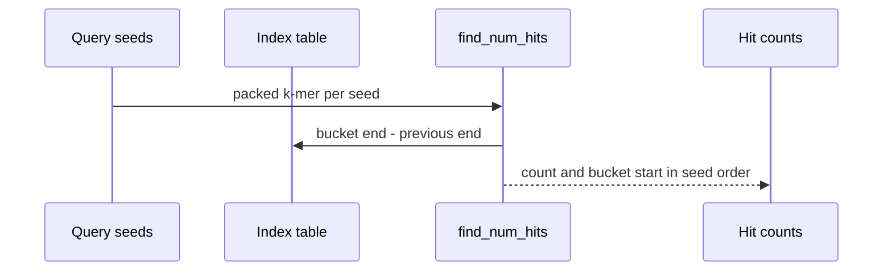
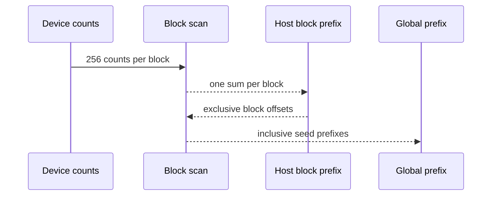
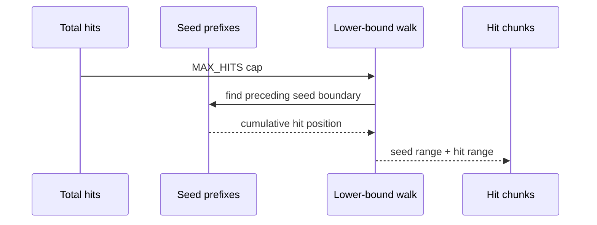
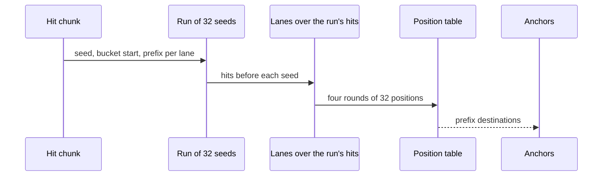
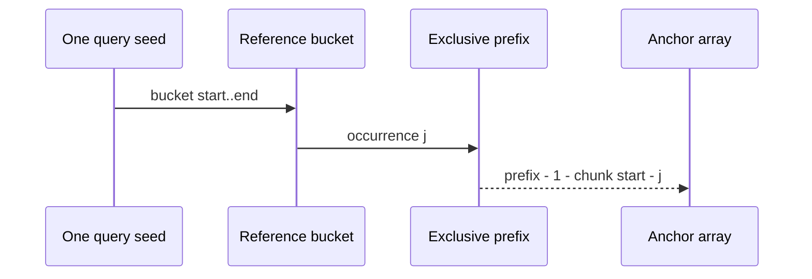

# Query seeds become ordered anchors

<!-- @source: src/gpu/kernels.rs::find_num_hits -->
<!-- @source: src/gpu/kernels.rs::scan_blocks -->
<!-- @source: src/gpu/mod.rs::chunk_limits -->
<!-- @source: src/gpu/mod.rs::chunk_limits_sparse -->
<!-- @source: src/gpu/mod.rs::exclusive_scan_hit_totals -->
<!-- @source: src/gpu/kernels.rs::find_hits_dense -->
<!-- @source: src/gpu/kernels.rs::find_hits_dense_warp -->
<!-- @source: src/gpu/mod.rs::use_warp_find_hits -->

## C.1 — Count each seed's reference occurrences
<!-- @id: c-count-hits -->
WHAT GOES IN: Query seed offsets and the reference index table.
WHAT HAPPENS: `find_num_hits` subtracts adjacent cumulative bucket ends for each seed and keeps the index of the bucket's first position beside the count, so the expansion does not read the index table a second time.
WHAT COMES OUT: One reference-hit count and one bucket start per query seed.
INVARIANT: Empty buckets contribute zero without changing seed order.

## C.2 — Turn counts into global prefixes
<!-- @id: c-scan-hits -->
WHAT GOES IN: Per-seed hit counts on the device.
WHAT HAPPENS: Device blocks scan locally, the host exclusively scans small block sums, then offsets are added back. A batch whose total exceeds the 32-bit hit index is refused, never wrapped.
WHAT COMES OUT: A global inclusive prefix and the total number of anchors.
INVARIANT: Only block sums cross the bus; when MAX_HITS cuts a batch, only the 256-count block holding each boundary is copied as well.

## C.3 — Cut at MAX_HITS boundaries
<!-- @id: c-chunks -->
WHAT GOES IN: Global hit prefixes, total hits, and the resolved MAX_HITS cap.
WHAT HAPPENS: The common case uses one chunk; oversized streams reproduce KegAlign's lower-bound walk over seed prefixes, located through the block sums (`HSPZ_CHUNK_WALK=full` copies the whole prefix array instead).
WHAT COMES OUT: Contiguous seed ranges and their exact hit ranges.
INVARIANT: A seed is never split across chunks, so a chunk may exceed MAX_HITS by one seed bucket.

## C.4 — Give each warp a run of 32 seeds
<!-- @id: c-mapping -->
WHAT GOES IN: One chunk's seeds with their bucket starts and inclusive hit prefixes.
WHAT HAPPENS: A warp owns 32 consecutive seeds (0.1.0). Each lane loads its own seed; the prefixes say how many of the run's hits come before each seed, and the lanes are then spread over the run's hits, each finding the seed that holds its hit with five shuffles. Four rounds of 32 positions are requested before any anchor is stored, so a warp has four loads in flight. `HSPZ_FIND_HITS_GROUPS=0` and `--paired` use the earlier mappings: one thread per seed, or one warp per seed at 8 or more hits per seed.
WHAT COMES OUT: The same packed anchors under any execution mapping.
INVARIANT: Mapping changes memory traffic, not prefix-derived destinations.

## C.5 — Expand buckets backwards
<!-- @id: c-expand -->
WHAT GOES IN: Seed prefixes, reference bucket positions, query positions, and chunk offsets.
WHAT HAPPENS: Every reference occurrence becomes a packed anchor written backwards from that seed's exclusive prefix.
WHAT COMES OUT: An anchor array in the raw order expected by the oracle.
INVARIANT: Reversing the per-seed bucket walk is load-bearing because this order feeds later MAX_HITS and dedup scopes.

