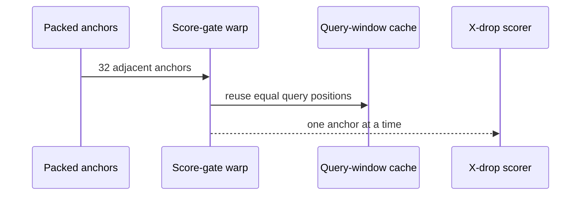
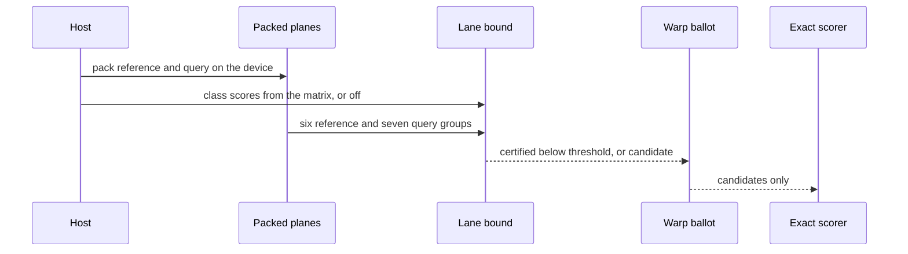
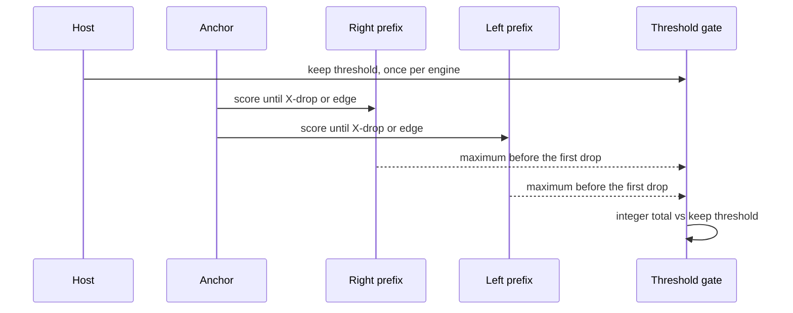
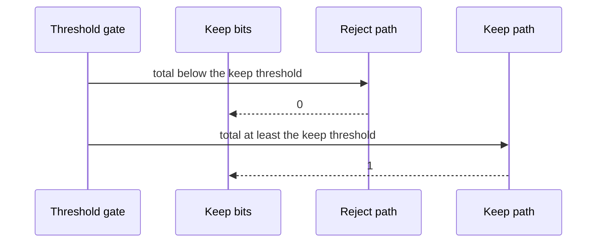
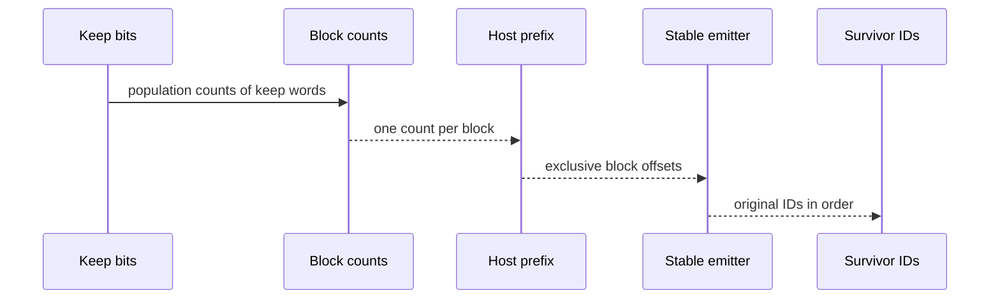
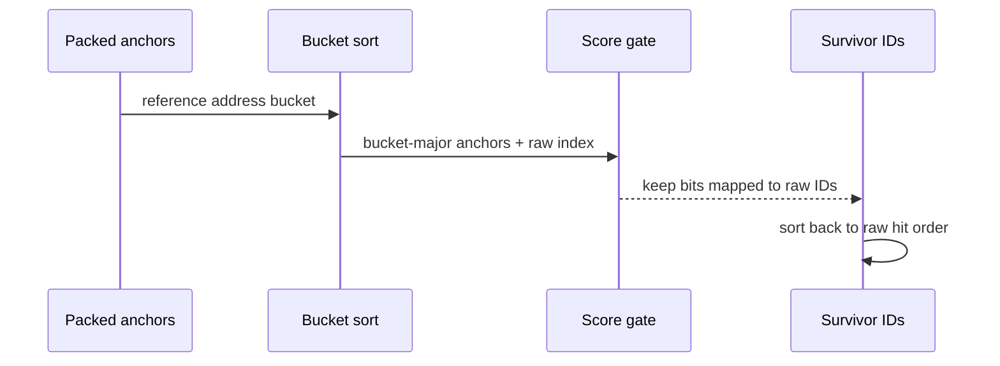

# Reject weak anchors before materialization

<!-- @source: src/gpu/kernels.rs::mark_score_survivors -->
<!-- @source: src/gpu/kernels.rs::count_survivors -->
<!-- @source: src/gpu/kernels.rs::emit_survivors -->
<!-- @source: src/gpu/mod.rs::seed_and_filter -->
<!-- @source: src/gpu/mod.rs::keep_threshold -->
<!-- @source: src/gpu/kernels.rs::bucket_scatter -->
<!-- @source: src/gpu/kernels.rs::mark_score_survivors_reordered -->
<!-- @source: src/gpu/kernels.rs::sort_survivors -->
<!-- @source: src/gpu/sieve.rs::classes -->
<!-- @source: src/gpu/sieve.rs::bound_words -->
<!-- @source: src/gpu/kernels.rs::pack_planes -->
<!-- @source: src/gpu/kernels.rs::mark_score_survivors_sieve -->
<!-- @source: src/gpu/kernels.rs::count_bits -->
<!-- @source: src/gpu/kernels.rs::emit_bits_plain -->

## D.1 — Feed coalesced anchor chunks to a warp
<!-- @id: d-coalesced-anchors -->
WHAT GOES IN: Packed `(reference-end, query-end)` anchors in raw hit order.
WHAT HAPPENS: A warp fetches 32 consecutive anchors coalescently and broadcasts one anchor at a time to its lanes.
WHAT COMES OUT: Shared query windows and per-anchor reference coordinates ready for scoring.
INVARIANT: Anchor order and identity are unchanged by the warp's memory mapping.

## D.2 — Bound each anchor from packed bases first
<!-- @id: d-sieve -->
WHAT GOES IN: The warp's 32 anchors, 2-bit packed planes of the reference and of the query strand, and three class scores taken from the substitution matrix.
WHAT HAPPENS: Each lane bounds its own anchor: over blocks of eight bases it counts matches and transitions across 64 bases to the right and 96 to the left (a side that has decided nothing there is carried on, 32 bases at a time, up to 128 and 160), stops at the first query base that is not an uppercase A, C, G or T, and checks whether the bound has fallen by more than X-drop. An anchor whose two sides are certified and sum below the keep threshold is rejected, and one ballot collects the rest.
WHAT COMES OUT: A 32-bit candidate mask per warp, about 0.02% of the anchors between human and mouse: the only ones the exact scorer of D.3 still walks.
INVARIANT: The bound never undercuts the exact score, so a rejected anchor would have failed the exact comparison too and the keep bits are unchanged; when a scoring matrix or X-drop breaks that guarantee, the host switches the bound off for the run and says why.

## D.3 — Compute a score-only X-drop bound
<!-- @id: d-score-only -->
WHAT GOES IN: One anchor, encoded sequences, substitution matrix, X-drop, and the keep threshold the host precomputed from K.
WHAT HAPPENS: Lanes score right and left prefixes four bases per lane and stop on the first X-drop or edge: one ballot marks the lanes with any drop, and each side reads the maximum before its first drop from its first dropping lane (from its last lane when nothing drops). Only the best total score is kept.
WHAT COMES OUT: An upper score for the anchored ungapped segment and its keep decision.
INVARIANT: The host computes once per engine the least total KegAlign's `f32`-rounded comparison keeps, so one integer comparison on the device decides exactly as that comparison does and the output is byte-identical.

## D.4 — Write one keep bit per decision
<!-- @id: d-flags -->
WHAT GOES IN: The score-only total and the keep threshold for hsp threshold K, for each candidate of the chunk.
WHAT HAPPENS: Lane 0 collects the chunk's decisions as bits and stores one 32-bit word per 32 anchors; an anchor the bound rejected is a zero bit that nothing has to store. With the bound off, the plain kernel writes one byte per anchor instead.
WHAT COMES OUT: A dense bitmask aligned with the anchor array the gate read.
INVARIANT: Rejection creates no HSP record, while every active word is overwritten before reuse.

## D.5 — Compact survivors without reordering
<!-- @id: d-compact -->
WHAT GOES IN: One keep bit per raw anchor (one byte with the bound off).
WHAT HAPPENS: Device blocks count the set bits, the host scans only block sums, and stable local ranks emit original anchor IDs.
WHAT COMES OUT: A small, increasing list of survivor IDs for full materialization.
INVARIANT: Stable compaction preserves raw hit order exactly, including under forced MAX_HITS chunking.

## D.6 — Optionally gate anchors by reference window
<!-- @id: d-ref-buckets -->
WHAT GOES IN: One chunk's packed anchors, when reference-locality bucketing is on for this engine (`HSPZ_REF_BUCKETS`).
WHAT HAPPENS: A stable counting sort groups the anchors into at most 32 reference-address buckets, so consecutive warps gather from one cached window (a warp learns which of its lanes share a bucket from one match instruction, 0.1.0); the gate then writes one keep bit per anchor. With the bound of D.2 on, a window is as long as its packed planes fit half of the L2 (64 Mbp on an A100), and the pass runs whenever such a window exists; without the bound the window is its bytes against three quarters of the L2, and `auto` times both paths before it chooses.
WHAT COMES OUT: Survivor IDs mapped back through each anchor's raw index and sorted into ascending raw hit order.
INVARIANT: The materializer sees the same survivors in the same order as without bucketing, so the HSP set and file bytes are unchanged.

